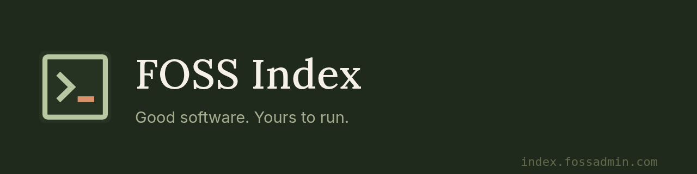
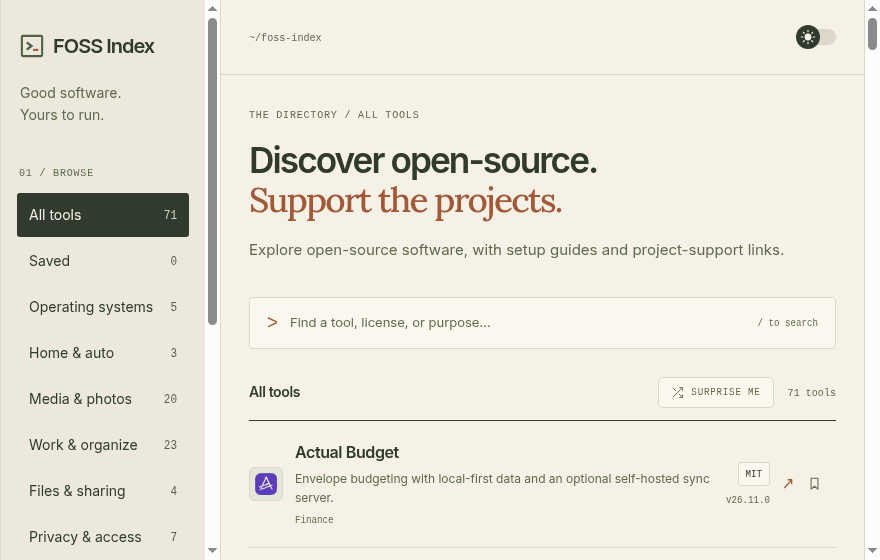

# FOSS Index

[](LICENSE)
[](https://index.fossadmin.com)
[](https://index.fossadmin.com)
[](https://gitlab.com/fossadmin/foss-index/-/pipelines)

[About](https://index.fossadmin.com/about/) / [Funding](https://index.fossadmin.com/funding/) / [Sponsor](https://index.fossadmin.com/sponsor/) / [Submit a tool](https://index.fossadmin.com/submit/) / [Contributing](CONTRIBUTING.md) / [License](LICENSE)

A curated, plain-HTML directory of open-source software. Each listing shows
the project's license, its recorded release and changelog, and a "Support this
project" panel. Live at **https://index.fossadmin.com**. It is a starting
point, not a ranking.

Built with Astro. The site is static: no server runtime, no accounts, no
analytics and no third-party scripts.



## What is on a listing

- **License badge** from the project's own repository, with a human review
  step before any label changes.
- **Recorded release** and changelog, kept as a committed snapshot, not a
  live guarantee. Projects without a GitHub release carry a version checked
  by hand against the project's own source, labeled "checked by hand".
- **Quick start or install notes** adapted from the project's official
  documentation. We have not run these setups ourselves unless a page says so.
- **Support this project**: the project's own funding link when one is
  recorded. A panel without one points to the source repository rather than
  inventing a destination.

Two small helpers run entirely in your browser: "Surprise me" opens a
random tool's page, and a bookmark button keeps a shortlist in `localStorage`
(`foss-index:saved`). That shortlist needs no account and is never sent
anywhere. Both are progressive enhancement and stay hidden without JavaScript.

## AI use

AI assistants do much of the coding, research and writing on this project,
under our direction. We remain responsible for what we publish, including
correcting mistakes.

A listing is a starting point, not an audit or a claim that we've
personally tested the tool. Screenshot captions identify their sources,
and quick-start notes say when we haven't run the instructions ourselves.

## Repository layout

| Path | What it holds |
|---|---|
| `src/content/docs/tools/` | One Markdown file per listing, with validated frontmatter |
| `src/content/docs/` | About, Funding, Sponsor and Submit pages |
| `src/data/releases.json` | Published release and license snapshot |
| `scripts/` | The release and license checker, with its tests |
| `public/` | Fonts, icons and screenshots, each with its own notice |
| `.gitlab-ci.yml` | GitLab Pages build, plus an optional manual release check |

## Run it locally

```sh
npm install
npm run dev        # http://localhost:4321
```

Build the static site:

```sh
npm run build      # outputs to dist/
npm run preview    # serve the build locally
```

NixOS: `nix build`, then `nix run nixpkgs#miniserve -- ./result -p 8080`. The
`npmDepsHash` in `flake.nix` is a placeholder; the first build should print the
real one to paste in. This route has not been verified against the current
lockfile.

## Add a listing

Copy any file in `src/content/docs/tools/`, fill in the frontmatter, then run
`npm run update-releases` and review its candidate before copying it into
`src/data/releases.json`. Set `category` and a two-letter `mark` (a local
typographic identifier, not an official logo). Category pages and counts come
from the frontmatter, and missing metadata fails the build.

To suggest a tool, use the Submit page on the site.

## Check release and license data

```sh
npm run test:releases
npm run update-releases
```

Despite its historical name, `update-releases` only checks. It does not write
the published `src/data/releases.json`. Review `.release-check/report.md` and
compare `.release-check/releases.candidate.json` with the published file.

- GitHub's latest stable release metadata goes into the candidate.
- Existing reviewed licenses stay intact. A different or unknown GitHub license
  detection is flagged for human review and never silently applied.
- New tools use their curated frontmatter license.
- No-release responses keep the prior release data.
- API or network failures leave published data alone and exit nonzero. No
  partial candidate is written.
- Checking stops on API 403 or 429 instead of continuing requests.
- Old report and candidate files are cleared before each check, so a failed run
  cannot leave an old candidate looking new.

An optional `GITHUB_TOKEN` environment variable raises GitHub's API allowance.
Never commit or paste a token. Default checking needs no credentials.

After reviewing release notes, license files and relevant install examples:

```sh
diff -u src/data/releases.json .release-check/releases.candidate.json
# Only after review; do not copy if a check failed or the baseline changed.
cmp src/data/releases.json .release-check/releases.baseline.json &&
cp .release-check/releases.candidate.json src/data/releases.json
npm run build
git diff -- src/data/releases.json
# Commit and push only the changes you have approved.
```

A version change does not update installation pins or screenshot captions.
License detection is repository-level, not proof of the terms for a version,
edition or bundled component. Check upstream license files before changing a
curated label. A pending license-review flag does not block building: it is a
human review item, not an automated legal verdict. Release notes in the JSON
are untrusted upstream text, not instructions to run commands.

GitLab has an optional manual `check-releases` job with a 14-day downloadable
report and candidate artifact. It neither commits nor deploys the candidate. No
schedule is enabled. For future automatic checking, first decide cadence and
review routing. Do not add write credentials or auto-publish license changes.

## Deploy

GitLab Pages builds and publishes `dist/` from the default branch
(`npm ci`, then `npm run build`). Nothing needs to run on a server.

Astro reads `CI_PAGES_URL` to set the hostname and base path; locally it falls
back to `https://index.fossadmin.com`. Published metadata updates stay manual:
check, review the candidate, apply, build, commit and push. No recurring
schedule or automatic source writes are enabled.

## Layout and privacy

The home page and category pages are plain HTML, including every tool link, and
category navigation works with JavaScript disabled. A small local script adds
name, purpose and license search and the `/` shortcut. Without JavaScript the
search control is hidden and every listing remains available.

No external requests, analytics, third-party scripts, remote icons or
embedded widgets.

The palette comes from the FOSSadmin site theme and its warm-terminal CSS.
Inter (400/600) and Lora (500) font files were copied from the first-party
font assets on https://fossadmin.com on 2026-10-21 and are served locally.
Their OFL licenses are included in `public/fonts/`. Labels use the system
monospace stack. Dark mode follows the system preference.

## License

The code and original text in this repository are licensed under the
GNU Affero General Public License, version 3 only (`AGPL-3.0-only`); see
[`LICENSE`](LICENSE). Fonts, screenshots, icons and the FOSSadmin name and
branding keep their own terms: see [`LICENSING.md`](LICENSING.md). The license
shown on each listing is that project's own, not this site's.
